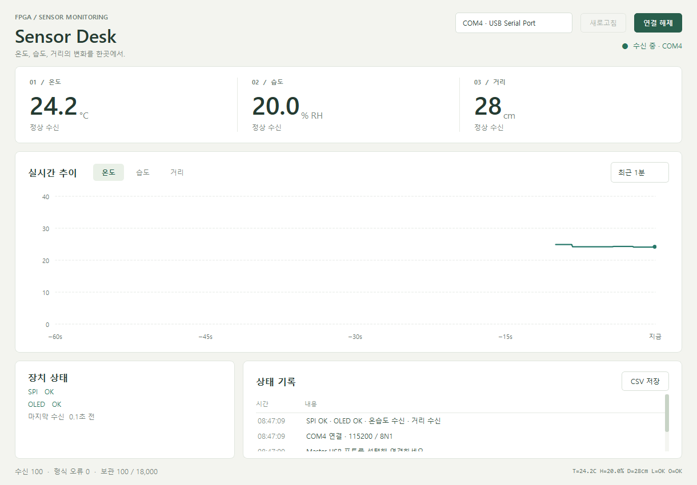

# fpga-spi-sensor-monitoring

Basys3 두 대를 SPI로 연결하는 센서 모니터링 수업 프로젝트입니다.
본인 담당은 `master/`의 Master 설계·구현·검증이며, `slave/`는 팀원이 담당합니다.
Master / Slave Interface Contract Rev.1과 Master Architecture Rev.1을 확정했습니다.
SPI 수신·센서 Frame 검사·FND·UART·SSD1306 OLED를 Master Top에 통합했습니다.
통합 Simulation과 배치배선을 통과했고, Master+OLED 실물에서 화면 표시·버튼 Reset 복구·PC UART 수신을 확인했습니다.
실제 Slave의 온습도·거리 SPI 수신과 OLED·FND 표시를 확인했습니다. 외부 I/O Timing은 아직 미검증입니다.
기본 기능 검토 결과와 확인 범위는 [최종 검토](docs/implementation.md#최종-검토와-확인-범위)에 정리했습니다.

## 담당 범위와 설계

- Slave의 온습도·거리를 SPI로 수신하고 FND·UART·OLED에 표시하는 Master 개발
- 보드 간 전용 SPI: Mode 0, 100kHz, 읽기 명령 1 Byte와 고정 응답 9 Byte
- 센서 유효 상태, Snapshot, Checksum, 중단·Reset·Timeout 복구를 공통 규칙으로 정의
- SSD1306 128×32 4핀 OLED는 보드 간 SPI와 별도의 I2C로 연결

배선·Timing·데이터 형식과 공통 검증 기준은 [Interface Contract Rev.1](docs/interface.md)에 정리했습니다.
80-bit 전송·센서 Frame 검사·출력·오류 복구를 13개 Self-checking Testbench, 총 **1,447건**으로 검증했습니다.
전체 Top 배치배선은 LUT 2,688개·Register 1,645개·Latch 0개, 내부 WNS 2.441ns·WHS 0.069ns입니다.
실물에서는 온습도·거리 수신, OLED·FND 표시, Master/Slave Reset 후 복구를 확인했습니다.
외부 I/O Timing Closure와 센서 정확도의 정량 검증은 수행하지 않았습니다.

Master는 `spi_master`의 전송, `sensor_reader`의 Frame 검사·데이터 저장,
FND·UART·OLED의 출력을 분리합니다. 출력 중에도 센서 수신을 계속하고 출력 대기 데이터는
최신 상태 한 개만 보관합니다. 세부 기준과 검증 범위는 [설계 및 검증](docs/implementation.md)에 정리합니다.

## PC 모니터

Qt 앱 **Sensor Desk**에서 USB-UART로 온습도·거리, 센서별 추이, SPI·OLED 상태를 확인하고 CSV로 저장합니다.
기존 FPGA 프로그램을 그대로 사용하며, 개선 후 COM4 실물 수신 100건·형식 오류 0건과 Qt 자동 시험 36건을 확인했습니다.
실제 USB 분리 시 오류 표시와 기록 보존, 재연결 후 수동 접속·센서값 복구도 확인했습니다.



`desktop/start.cmd`를 실행해 Master 포트를 선택합니다. 실행·빌드·표시 기준은 [PC 앱 안내](desktop/README.md)에 정리했습니다.

## 프로젝트 열기

- Master 확인 Tool: Vivado 2026.1 (SW Build 6511674), Windows
- Project: `master/spi_sensor_master.xpr`
- Device 설정: `xc7a35tcpg236-1`
- Board 설정: `digilentinc.com:basys3:part0:1.2`

Vivado에서 `master/spi_sensor_master.xpr`를 엽니다. Board files가 검색되지 않으면
Basys3 board repository 설정을 확인해야 합니다. 프로젝트에 저장된 사용자별 경로는
다른 PC에서 유효하지 않을 수 있습니다. Basys3 `board.xml`을 포함한 실제 Board repository의
`boards` 경로를 해당 PC의 Vivado에 설정해야 합니다.

팀원 Slave 프로젝트는 `slave/spi_sensor_slave.xpr`이며 XPR 생성 버전 표기는 Vivado 2020.2입니다.
Slave 프로젝트의 로컬 Tool 호환성·재빌드는 확인하지 않았으며, 실제 보드와의 SPI 수신은 검증했습니다.

Design Top은 `spi_sensor_master_top`, Simulation Top은 `tb_master_oled`입니다.
BTNC는 Reset, SW[1:0]은 온도(00/11)·습도(01)·거리(10) 선택입니다.
SPI는 승인된 JB1~4, UART TX는 A18이며 FND·LED·100MHz Clock을 XDC에 반영했습니다.
Pin 기준과 연결은 [보드 Top 검증](docs/implementation.md#보드-top-검증-결과)을 참고합니다.
OLED 연결은 **SCL=JA1(J1), SDA=JA2(L2), GND=JA5, VCC=JA6(3.3V)**입니다.
LED[11]과 UART `O=ERR`는 OLED 초기화·갱신 실패 상태이며, 전체 갱신 성공 후 `O=OK`로 복구합니다.
Master+OLED 단독 시험에서는 Slave 분리로 `L=ERR:HEADER`와 센서 `--`가 표시됩니다.
128×32 실물 패널에 맞춰 초기화와 화면을 네 줄(온도·습도·거리·링크/오류)로 구성했습니다.
실제 Slave 온습도 수신과 OLED 규격 수정의 근거는 [보드 연동 결과](docs/implementation.md#보드-간-연동과-oled-규격-수정)에 정리합니다.
초음파 거리의 수신·표시 확인 결과는 [실제 거리 연동](docs/implementation.md#실제-초음파-거리-연동)에 정리했습니다.
2026-11-05 Master USB 전원 분리·재인가 후 별도 Programming 없이 UART가 재개되고 OLED 정상 표시를 확인했습니다.
이는 해당 실물 구성의 부팅 동작 확인이며, Flash 내용의 해시 비교는 수행하지 않았습니다.
외부 SPI I/O Timing은 미확정이며 현재 Tool 결과로 보드 연결의 정상 동작을 보장하지 않습니다.
XDC의 QSPI boot 설정은 보드 간 센서 통신의 SPI 설계를 의미하지 않습니다.

## 독립 검증 실행

Vivado 명령이 PATH에 설정된 환경에서 실행합니다.

```powershell
python scripts/verify_spi_master.py
python scripts/verify_spi_master.py --synth
python scripts/verify_spi_master.py --sensor
python scripts/verify_spi_master.py --sensor --synth
python scripts/verify_spi_master.py --fnd
python scripts/verify_spi_master.py --fnd --synth
python scripts/verify_spi_master.py --uart
python scripts/verify_spi_master.py --uart --synth
python scripts/verify_spi_master.py --top
python scripts/verify_spi_master.py --top --synth
python scripts/verify_spi_master.py --top --impl
python scripts/verify_spi_master.py --i2c
python scripts/verify_spi_master.py --i2c --synth
python scripts/verify_spi_master.py --oled
python scripts/verify_spi_master.py --oled --synth
```

기본 명령은 SPI, `--sensor`는 Reader 단위·SPI 연결, `--fnd`는 FND 단위·SPI부터 표시까지의 연결 검증입니다.
`--synth`는 해당 모듈의 독립 합성입니다.
`--uart`는 Byte 송신·Reporter·SPI부터 UART 직렬 출력까지 검사합니다.
`--top`은 Reset·입력·LED·FND·UART를 함께 검사하며, `--top --synth`는 실제 XDC를 적용한 전체 Top 합성입니다.
`--top --impl`은 기본 Parameter로 합성·배치배선·Timing/DRC 검사 후 Bitstream을 생성합니다. 보드를 Programming하지 않습니다.
`--i2c`는 OLED용 Write·ACK/NACK·Clock Stretch·Timeout을 검사하며, `--i2c --synth`는 양방향 I/O Buffer를 포함한 단독 합성입니다.
센서 검증에서는 Poll·Stale 시간을 줄이고 SPI는 실제 100kHz 설정을 사용합니다.
`--oled`는 SSD1306 직렬 모델의 화면 RAM·Snapshot·실패 복구와 SPI→OLED/UART 통합을 검사합니다.
보드 UART 수신은 `./scripts/capture_uart.ps1 -Port COM4 -Seconds 8`로 기록합니다(Port는 실제 장치에 맞춤).
로그·Report·Waveform은 Git에서 제외한 `master/spi_sensor_master.sim/step4/`~`step11/`에 생성합니다.
Bitstream은 `step9/spi_sensor_master.bit`, 입력·산출물 해시는 같은 폴더의 `build_manifest.json`에 기록합니다.

## 파일 관리

`master/spi_sensor_master.xpr`와 `master/spi_sensor_master.srcs/`는 프로젝트 입력으로 보존합니다.
Cache, 실행 결과, Hardware session, Vivado session log는 `.gitignore`로 제외하며,
Source나 검증 근거의 확장자 전체를 Ignore하지 않습니다.
