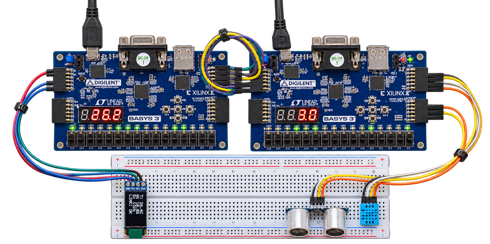
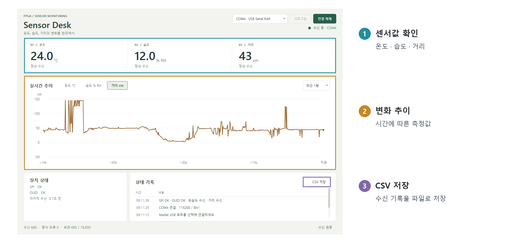

# FPGA SPI Sensor Monitoring

두 Basys3를 SPI로 연결해 DHT11의 온습도와 HC-SR04의 거리를 수집하고, OLED·FND와 Qt 앱에서 확인하는 센서 모니터링 시스템입니다.

**담당: Master FPGA 설계·검증, 보드 간 인터페이스 정의, Qt 모니터 구현.** 센서 Driver와 Slave FPGA는 팀원이 담당했습니다.

왼쪽은 Master, 오른쪽은 Slave입니다. 두 보드는 SPI로 연결하고 OLED는 Master, 센서는 Slave에 연결했습니다.

## 시연

온습도·거리 변화와 연결 오류·복구 동작을 보여줍니다.

https://github.com/user-attachments/assets/2906fe24-5ce1-4fc6-8414-091c8f5ddaaa

[영상 파일(MP4)](docs/assets/video/sensor_monitoring_demo.mp4)

## 핵심 구현

| 구분 | 구현 내용 |
| --- | --- |
| 보드 간 SPI | Mode 0·100kHz·80bit 고정 전송, 100ms 주기로 센서 Snapshot 수신 |
| 데이터 검증 | 길이·Header·XOR·예약 Bit·값 범위 검사, 센서 미준비와 통신 오류 구분 |
| 출력·복구 | OLED·FND·UART 표시, Timeout·수신 정지 감지, 정상 응답 후 표시 복구 |
| Qt 모니터 | USB-UART 비동기 수신, 센서별 추이·상태 기록·CSV 저장 |

SPI 전송, 수신 검증, 표시 모듈을 분리했습니다. 정상 Frame만 센서값과 유효 상태를 함께 반영하며,
느린 OLED·UART 출력 때문에 SPI 수신이 멈추지 않도록 최신 출력 대기 상태 한 개를 보관합니다.

## 검증 결과

| 검증 | 결과 |
| --- | --- |
| Master Simulation | Self-checking Testbench 13개, 1,447건 PASS |
| Master 배치배선 | LUT 2,688·FF 1,645·Latch 0, 내부 WNS 2.441ns·WHS 0.069ns, DRC 위반 0 |
| Qt 자동 시험 | QtTest 36건 PASS |
| 실물 연동 | 센서값 SPI 수신·OLED/FND/Qt 표시, Reset 후 복구, USB 수동 재접속·CSV 기록 확인 |

FPGA 결과는 2026-11-04, Qt 자동 시험은 2026-11-06 기록입니다.
외부 SPI I/O Timing Closure와 센서 정확도의 정량 검증은 포함하지 않습니다. [검증 범위](docs/implementation.md#검증-결과)

Qt 모니터링 화면 펼쳐보기

## 실행

- **FPGA:** Vivado에서 [Master 프로젝트](master/spi_sensor_master.xpr)를 엽니다. 확인 환경은 Vivado 2026.1, Device는 `xc7a35tcpg236-1`입니다.
- **Qt:** Qt 6 MinGW 환경에서 `desktop/start.cmd` 실행 후 Master USB 포트를 선택합니다.

## 문서

| 문서 | 내용 |
| --- | --- |
| [발표자료(PDF)](docs/presentation/fpga_spi_sensor_monitoring_presentation.pdf) | 시스템 구성·구현·시험 결과·문제 해결 |
| [설계·검증](docs/implementation.md) | 시스템 구성, Master 모듈 역할, 오류 처리와 검증 결과 |
| [인터페이스](docs/interface.md) | 보드·센서 배선, SPI Timing·Frame·유효 상태 규약 |
| [Qt 실행 안내](desktop/README.md) | 실행·빌드·포트 연결·CSV 저장·자동 시험 |
