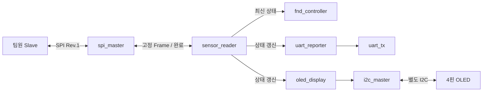

# Master 설계 및 검증

기준: Interface Contract Rev.1 (`43f9968`), 2026-11-03.
STEP 2의 Wire Format·Pin·SPI Timing·센서 Valid / Age 규칙은 변경하지 않는다.
Architecture Rev.1 사용자 승인일: 2026-11-03. 아래 모듈 구성과 동작은 승인된 구현 기준이다.
이 설계 승인이 모든 모듈의 구현·Simulation·Hardware 검증 완료를 의미하지 않는다.

현재 구현: [spi_master.v](../master/spi_sensor_master.srcs/sources_1/new/spi_master.v),
[sensor_reader.v](../master/spi_sensor_master.srcs/sources_1/new/sensor_reader.v),
[fnd_controller.v](../master/spi_sensor_master.srcs/sources_1/new/fnd_controller.v)와 독립 Testbench.
UART·OLED·보드 통합 모듈은 구현 계획이다. 실제 실행 결과는 문서 끝의 검증 결과와 구분한다.

## 목표와 완료 기준

- SPI 전송, 센서 Frame 해석, 출력의 책임과 상태 소유권이 분명하다.
- 모듈 Handshake·Clock·Reset·Timeout·Snapshot 경계가 서로 맞는다.
- 느린 출력이 SPI를 막지 않고, 잘못되거나 오래된 값을 정상 데이터로 표시하지 않는다.
- Rev.1의 Golden Vector를 Master 독립 검증에 연결할 수 있다.
- 실제 기능이 없는 상태와 설계 제안을 구분한다.

## 구조와 책임

`spi_sensor_master_top`은 연결, Reset 배포, 표시 선택 입력 동기화, LED 배치만 담당한다.
센서 수집 Driver나 실제 Slave SPI는 이쪽에서 구현하지 않는다. 공통 Tick·FIFO·Bus Arbiter·별도 Frame Decoder 모듈은 만들지 않는다.
기능별 책임이 분명한 단위만 분리하고, 단순 Counter와 검사식은 해당 모듈 내부에 둔다.

| 모듈 | 책임 / 보유 상태 |
| --- | --- |
| reset_sync | 외부 Active-high Reset의 비동기 Assert·동기 Release |
| spi_master | CS·SCLK·MOSI, MISO 동기화·Shift, Bit 수, Setup/Hold/Gap, 2ms 선택 Watchdog |
| sensor_reader | Poll 주기, 요청 Frame, 완료 Frame 검사, 최신 값·Valid·링크 상태·수신 정지 시간 |
| fnd_controller | 표시 선택·숫자 변환·자리 Scan, 한 Scan 동안의 표시 Snapshot |
| uart_reporter / uart_tx | 고정 최대 길이 ASCII 레코드 생성 / 8N1 Bit 전송 |
| oled_display / i2c_master | 초기화·Glyph·화면 갱신 / 주소·ACK·Byte·START/STOP·Bus Timeout |

설계 시작 시 Master에 재사용할 RTL은 없었다. XPR 틀과 XDC 템플릿만 재사용하고, 새 RTL은 아래 단위로 작성한다.
현재 `slave/`에는 팀원이 추가한 빈 `top`과 초기 XPR·XDC가 있다. XPR 생성 버전은 2020.2,
Master는 2026.1이며, Slave를 열어 변환하거나 수정하지 않았다. 실제 기능 호환성은 아직 미검증이다.

## Clock / Reset / 작성 규칙

- 내부 Logic은 Basys3의 100MHz `clk` 하나만 사용한다. SPI SCLK·UART baud·FND scan·I2C는 Counter / Enable로 제어하고 내부 Clock으로 쓰지 않는다.
- `reset_sync`는 2단계 Release 동기화를 사용하고, Power-on 초기화 상태를 Reset Assert로 지정한다. 나머지 Logic은 동기 Active-high `rst`를 공통 사용한다.
- System Clock이 동작하는 조건에서 외부 Reset Assert 후 다음 Clock에 내부 상태와 출력이 Reset된다. Release는 동기화 후 수행한다.
- Reset 출력: SPI CS_n=1/SCLK=0/MOSI=0, UART TX=1, FND 모든 자리·Segment OFF, I2C SDA/SCL 해제, Sensor/Link Valid=0.
- `spi_master`는 Reset 해제 뒤에도 10µs CS High gap을 먼저 보장한 다음 요청을 받는다. 외부 Reset을 Slave로 전달하지 않는다.
- MISO는 `spi_master` 내부 2-FF Synchronizer를 통과시킨 뒤 SCLK 상승 사건에서 수신한다. 동기화 지연을 포함해 Rev.1 Timing 예산을 만족하는지 검증한다.
- 표시 선택 입력은 Top에서 각 Bit를 2-FF 동기화한다. UI 선택용이며 원자적 Multi-bit Data 전달로 취급하지 않는다.
- HDL은 `.v`, Verilog-2001 수준으로 작성한다. 명시적 `wire/reg`, Sequential Non-blocking / Combinational Blocking, `lower_snake_case`, 상수 `UPPER_SNAKE_CASE`, Instance `u_<module>`를 사용한다.
- Tool Attribute가 필요한 Synchronizer는 `ASYNC_REG` 적용과 합성 후 인식을 확인한다. Latch·암묵적 폭 축소·불필요한 Clock Domain을 만들지 않는다.

## spi_master: Frame 단위 전송

Byte별 start/done 왕복으로 CS를 끊거나 Byte 사이 Pause를 만드는 구조를 피한다.
Frame 길이는 Rev.1의 10 Byte(80 Bit)로 고정한다. SPI core는 명령·센서 필드를 해석하지 않고 Raw Frame만 전송한다.
Clock과 Timing 상수는 검증 시 축소 가능한 Parameter로 두되 실제 보드 설정은 Rev.1 값을 사용한다. Runtime 가변 길이는 추가하지 않는다.

| 신호 | 의미 |
| --- | --- |
| start | `busy=0`에서 1 Clock만 발생시키는 요청 |
| tx_frame[79:0] | 수락 Edge에서 복사. 상위 Byte부터 전송 |
| busy | 수락 후 Setup / 전송 / Hold / Gap 동안 1. Reset 후 초기 Gap에도 1 |
| done | Gap까지 끝난 결과 알림, 1 Clock. 성공과 Timeout 모두 발생 |
| error | done과 함께 유효한 Timeout 결과. 다음 수락까지 보존 |
| rx_frame[79:0] | Command 구간의 무시 Byte를 포함한 수신 결과. 다음 수락까지 보존 |
| rx_bits[6:0] | 실제로 내부에서 수신 처리한 Bit 수. 정상 80, Timeout은 진행된 수 |

`start && !busy`에서만 요청을 수락한다. Busy 중 start는 수락하지 않고 큐에 넣지 않는다.
Done을 관측한 Cycle에는 결과가 안정되어 있고 Busy=0이다. 상위는 다음 Cycle 이후 새 요청을 발생시킨다.
수락한 요청 하나에 done은 한 번만 발생한다. Reset은 진행 중 요청을 취소하며, Reset과 초기 Gap 종료만으로 done을 발생시키지 않는다.
정상 전송 중 Timer와 MISO 동기화는 100MHz로 계속 동작하며 SCLK Enable에 묶지 않는다.

제어 상태는 IDLE → CS_SETUP → TRANSFER → CS_HOLD → CS_GAP → IDLE로 둔다.
Reset은 초기 CS_GAP으로 복귀한다. TRANSFER는 Byte가 아닌 80-bit Shift·Bit Counter로 진행한다.
500 System Clock마다 SCLK Half-period를 진행하고 첫 Bit를 첫 상승 전에 준비한다.
마지막 Bit를 수신한 뒤 마지막 하강·Hold·Gap까지 완료해야 정상 done을 낸다.
선택 Watchdog는 CS_n 하강부터 상승까지 세며 2ms 초과 시 즉시 CS_n=1/SCLK=0/MOSI=0,
미완성 결과를 error로 표시하고 Gap을 거쳐 done을 낸다. Watchdog는 SCLK 진행과 독립이다.

## sensor_reader: 요청·검사·데이터 저장

첫 요청은 Reset 후 SPI가 준비되면 시작한다. 이후 요청 시작 간격은 100ms를 목표로 한다.
하나의 sensor_reader만 SPI core를 소유한다. 다른 모듈은 start를 구동하지 않는다.
일반 Poll Timer는 수락한 요청 시작에서 다시 세며, 지연 때문에 밀린 요청을 쌓거나 몰아서 보내지 않는다.
만료 시 SPI가 Busy이면 Pending 요청 한 개만 유지하고 Idle에서 실행한 뒤 새 주기를 시작한다.
SPI 정상 전송은 약 0.8ms이므로 기본 주기에 비해 충분히 짧다. 이 계산은 성능 실측이 아니다.

Controller는 WAIT_POLL / WAIT_TRANSFER / CHECK_FRAME 세 단계로 분리한다.
WAIT_POLL에서 Poll이 Due이고 SPI가 Idle일 때만 요청을 1 Cycle 발생시키고 WAIT_TRANSFER로 이동한다.
TX Frame은 그 수락 Edge까지 유지한다. 초기 SPI Gap 동안에는 첫 요청을 보류한다. Done에서 결과를 복사하고,
CHECK_FRAME에서 검사·상태 반영을 수행한다. 한 번의 요청에 done을 한 번만 소비한다.

| 상위 Bit 구간 | 해석 |
| --- | --- |
| rx_frame[79:72] | 무시 Byte |
| [71:64] / [63:56] | Header A5 / STATUS |
| [55:40] | signed TEMP, 0.1°C |
| [39:24] | unsigned HUM, 0.1%RH |
| [23:8] / [7:0] | unsigned DIST(cm) / XOR |

TX는 `80'h01000000000000000000`. Frame 검사는 Transport error → 길이 80 → Header → XOR → Reserved Bit → Valid 필드 범위 순서로 한다.
범위는 Rev.1 그대로이며 signed TEMP 비교를 unsigned 비교로 바꾸지 않는다. 잘못된 Frame은 부분 반영하지 않는다.

- 정상 Frame: 온도·습도·거리·Sensor Valid를 같은 Clock에 반영하고 `link_valid=1`, `last_error=NONE`, 수신 Age=0.
- STATUS=0도 정상 Frame이다. 링크는 정상이고 센서는 미준비인 상태로 표시한다.
- Frame 오류·Timeout: 이전 숫자 Register는 보존하지만 Sensor Valid와 link_valid는 0. 잘못된 값으로 덮어쓰지 않는다.
- 마지막 정상 형식의 Frame 이후 500ms 이상 새 정상 Frame이 없으면 로컬 Stale로 처리하고 Valid를 지운다.
- 수신 Age는 CHECK_FRAME에서 성공을 반영한 Edge에 0이 되고, 이후 50,000,000번째 100MHz Clock Edge에서 500ms 경계에 도달한다.
  그 Edge에 성공 결과가 없으면 Stale로 반영한다. 성공 Frame만 Age를 초기화하며 Counter 만료 뒤 Wrap으로 다시 Fresh가 되는 것을 허용하지 않는다.
- 센서의 3s / 250ms Age는 Slave의 책임이고, Master의 500ms는 통신 결과의 갱신 여부를 보는 별도 정책이다.
- Reset 직후 숫자·Valid·link_valid는 0이고 오류 표시는 아직 NONE이다. 첫 성공 전에도 500ms 수신 정지 감시는 동작한다.
- 같은 Edge에 Frame 검사 완료와 Stale 판정이 겹치면 성공은 Age=0·link_stale=0으로 반영한다.
  오류이면 Age는 초기화하지 않고 계속 진행해 경계에서 link_stale=1이 되며, last_error에는 그 Frame 오류 이유를 남긴다.
  오류 처리 때문에 Age Counter가 멈추거나 Stale 경계가 계속 미뤄져서는 안 된다.

Data Record는 `temperature[15:0]`(signed), `humidity[15:0]`, `distance[15:0]`,
`sensor_valid[1:0]`, `link_valid`, `link_stale`, `last_error[2:0]`의 Register 묶음이다.
오류 이유는 NONE / TIMEOUT / LENGTH / HEADER / XOR / RESERVED / RANGE / STALE를 각각 0..7로 정의한다.
Raw Debug 전용 `debug_rx_byte[7:0]`는 rx_bits=80인 완료 결과에서만 rx_frame[15:8]로 갱신한다.
미완성 Timeout에서는 기존 Debug Byte를 유지한다. Sensor Record와 별개이며 Frame의 유효성을 보장하지 않는다.

`report_update`는 정상 Frame 수신(값이 같아도 포함), 실패 결과, 첫 Stale 전환에서 1 Cycle 발생한다.
Record와 Pulse는 함께 Register로 갱신되어 다음 수신 Clock Edge에서 소비 가능하고 다음 갱신까지 안정된다.
공통 100MHz Domain 안에서 전체 Record를 같은 Edge에 복사하므로 별도 Multi-bit CDC나 FIFO가 필요하지 않다.
`sample_toggle`은 정상 Frame마다 토글해 Debug에 사용한다.

## 출력과 Backpressure

출력 모듈이 Sensor Reader에 Ready를 돌려주거나 Poll을 멈추는 연결은 두지 않는다.
UART / OLED는 각자 현재 출력용 Snapshot과 Pending 최신 Record 한 개를 보유한다.
Busy 중 Update가 여러 번 오면 Pending을 최신 값으로 대체한다. 현재 메시지·화면에는 섞지 않는다.
Idle로 복귀하는 Edge에 Update가 함께 오면 새 Update를 이전 Pending보다 우선해 다음 출력을 시작한다.
Reset 시 현재 출력 동작과 Pending Valid·길이·위치를 취소한다. Reset 전 Record를 후속 레코드로 재전송하지 않는다.
Payload 배열 전체를 초기화하는 대신 유효 상태와 Index를 초기화해 미사용 내용이 출력되지 않게 한다.
중간 Update가 생략될 수 있는 상태 모니터이며 모든 Poll을 보존하는 Data Logger는 아니다.

### FND

`display_sel[1:0]`은 00=온도, 01=습도, 10=거리, 11=온도로 해석한다.
온습도는 소수 한 자리와 필요 시 Minus, 거리는 정수 cm를 표시한다. Invalid이면 `----`를 표시한다.
FND에는 단위를 넣지 않고 선택 상태와 UART / OLED로 구분한다.
전체 네 자리 Scan 시작에서 선택·값·Valid를 함께 복사해 한 Scan 중 숫자가 섞이지 않게 한다.
자리 갱신 간격 250µs, 전체 Refresh 1ms를 목표로 하며 Active-low an/seg를 사용한다.
자리 전환 시 자리 OFF·Segment 갱신·새 자리 ON 순서로 제어한다. 실제 Ghosting·밝기는 Hardware에서 확인한다.

### UART

TX-only, 115200 baud, 8N1을 사용한다. RX 명령·FIFO·PC 제어 Protocol은 추가하지 않는다.
`uart_reporter`는 최대 64 Byte의 한 줄을 생성하고 `uart_tx`의 `start/data[7:0]/busy/done`으로 한 문자씩 전달한다.
`uart_tx`는 Idle/Start/Data/Stop을 처리하고 Stop Bit가 끝난 후 done을 낸다. Busy 중 start는 수락하지 않는다.
start는 Busy=0에서 1 Cycle만 발생시키고 Data는 수락 Edge에 복사한다. Reporter는 done 이후 다음 Cycle부터 다음 문자를 요청한다.
예: `T=23.5C H=60.0% D=291cm L=OK O=OK` + CRLF. Invalid 센서는 `--`, 링크 오류는 `L=ERR:<reason>`, OLED 오류는 `O=ERR`로 표현한다.
UART Reporter는 Sensor Record 외에 oled_display의 동기 `oled_fault`를 읽기 전용 입력으로 받는다.
report_update 또는 oled_fault 변화 때 현재 Record와 OLED fault를 함께 Pending에 복사한다.
fault 변화 감지용 이전 상태도 Reset에서 지운다. 이 상태 경로는 sensor_reader나 SPI 제어로 되돌아가지 않는다.
Reset 후 첫 메시지 앞에 CRLF를 보내 중단된 이전 텍스트와 새 레코드를 분리한다.
64 Byte의 8N1 전송은 nominal 약 5.56ms로 100ms Poll 간격보다 짧다. 단위 변환은 정수 연산으로 한다.

### OLED / I2C

`oled_display`는 초기화, 숫자·문자 Glyph, 페이지별 Byte 생성을 담당하고 `i2c_master`는 Bus Timing과 ACK를 담당한다.
I2C는 우선 100kHz, Write-only 사용, SDA/SCL은 Low 구동 또는 해제로 제어하고 실제 Pin을 읽어 ACK·Bus 상태를 확인한다.
주소·패널 해상도·초기화 값·Pull-up 전압은 실물 확인 전 고정하지 않는다.
I2C Timeout의 구체적인 값도 선택할 모듈 사양·Packet 길이에 맞춰 OLED 구현 전에 확정하고 검증한다. 4핀에는 외부 Reset이 없으므로 초기화·전원 조건을 확인해야 한다.
전체 Framebuffer 대신 현재 Record에서 Glyph / Page Byte를 순차 생성하는 방식을 우선한다.
고정 Snapshot은 전송 생성 중 Data 일관성을 뜻한다. 페이지 쓰기 중에는 화면의 이전·새 영역이 함께 보일 수 있고,
4핀 모듈에는 FR 동기화 신호가 없으므로 화면 전체의 원자적 전환이나 Tearing 방지를 보장하지 않는다.

`i2c_master`의 Packet start/busy/done/error와 `tx_valid/tx_ready/tx_data[7:0]/tx_last`로 Byte를 공급한다.
Valid가 Ready로 수락될 때까지 Data/Last를 유지한다. SPI와 달리 I2C Byte 사이의 준비 대기는 SCL LOW 구간에서 처리한다.
주소+Write, 각 Byte ACK, 마지막 Byte 뒤 STOP을 처리한다. NACK / Bus Timeout이면 해당 갱신은 실패로 종료한다.
SCL LOW 대기·Bus Busy가 끝나지 않아도 내부 Watchdog는 System Clock으로 동작하며 실패 시 SDA/SCL 구동을 해제한다.
장애 상태에서 무조건 정상 STOP이 만들어졌다고 보고하지 않는다. 초기화·화면 갱신 중 어떤 Packet이라도 실패하면
현재 갱신을 중단하고 fault를 유지한다. 실패한 Byte부터 이어 쓰지 않고 500ms 대기 후 재초기화·전체 갱신을 재시도한다.
대기 중 Pending은 계속 최신 Record로 바뀌며, 재시도 때 최신 Snapshot을 사용한다. 재초기화와 전체 갱신이 모두 성공해야 fault를 지운다.
OLED 실패는 OLED fault로만 표시하고 Sensor Valid / SPI link 상태를 지우지 않는다. OLED 미연결이어도 나머지 기능은 진행한다.
I2C가 끊기면 기존 화면을 지우거나 고장 표시를 쓸 수 없을 수 있다. 이때 OLED 화면의 최신성을 보장하지 않고 LED·UART의 fault를 근거로 판단한다.

## Debug LED

| LED | 의미 |
| --- | --- |
| [7:0] | debug_rx_byte: 80 Bit가 수신된 최근 결과의 DIST_L 위치 Byte. 오류 Frame일 수도 있으며 미완성 Timeout에서는 유지 |
| [8] / [9] | DHT_VALID / DIST_VALID |
| [10] | 정상 Frame 수신 Toggle |
| [11] | OLED fault |
| [12] | SPI busy |
| [13] | last_error가 NONE이 아님: Frame 오류·Timeout·로컬 Stale 포함 |
| [14] | 정상 형식 Frame 수신 정지 500ms 이상 |
| [15] | link_valid: 최근 정상 형식 Frame, 로컬 Stale 아님 |

이 LED의 정상 의미는 운영 상태다. Golden Vector·Timing·Hardware 시험의 PASS를 대신하지 않는다.
표시 선택은 보드 Switch 입력 두 개로 계획하되 실제 Package Pin은 출력 통합 시 XDC에서 대조한다.

## 제약과 검증 단위

- XDC는 100MHz System Clock(10ns)과 승인 SPI Pin을 실제 Top Port에 맞춰 반영한다. 이번 단계에서는 수정하지 않는다.
- SCLK는 내부 FF의 Clock으로 쓰지 않으므로 내부 SCLK Domain을 임의로 만들지 않는다. 외부 I/O 지연과 MISO Synchronizer는 구현 구조에 맞춰 제약·보고서를 검토한다.
- Synchronizer 첫 단계의 비동기 경로만 근거를 갖고 다룬다. 모든 SPI 경로를 통째로 False Path 처리해 Timing 검사를 숨기지 않는다.
- STEP 4: spi_master 독립 검증. 80 Bit·CS 경계·첫/마지막 Bit·MISO 지연·Reset·Timeout·Gap과 Busy 중 요청을 확인한다.
  요청당 done 한 번, Reset 취소 후 done 없음, 초기 Gap 종료의 가짜 done 없음을 포함한다.
- STEP 5: sensor_reader와 Behavioral Slave 검증. Rev.1 G1~G21 중 각 모듈이 책임지는 조건, 원자적 반영·오류·Stale·재요청을 확인한다.
- 이후: LED·UART·FND 독립 및 통합 → 팀원 준비 상태에 따라 고정 Vector 기반 보드 연동 → 실물 확인 후 OLED.
- 느린 UART/OLED, 연속 상태 갱신, 출력 장애 중에도 SPI가 계속 동작하는 것을 통합 검증한다.
  완료와 새 Update가 겹칠 때 최신 Record 우선, Reset 시 Pending 폐기, 오류 Frame과 500ms Age 경계의 동시 발생을 검사한다.
  OLED의 갱신 도중 실패·부분 화면 잔류·재초기화 후 전체 갱신 복구도 확인한다.
- Protocol 오류 Vector는 Master Mock이 주입한다. 팀원 Slave가 일부러 잘못된 응답을 만들도록 구현하지 않는다.
- Behavioral Slave는 Master의 `sim_1`에만 등록한다. Design Source나 실제 Slave 프로젝트의 대체물로 등록하지 않는다.

## 현재 경계와 승인

Wire Contract Rev.1 변경은 없다. OLED 실물 사양·전압·Pin, 센서 전압 보호, 보드 Revision과 팀원 구현 호환성은 여전히 미확인이다.
Architecture 승인은 내부 폭·주기·Frame Mapping·모듈 책임의 정적 검토 결과다.
SPI 전송 Core·Sensor Reader·FND를 아래 범위로 실행·검증했다. 전체 Architecture의 구현 완료를 뜻하지 않는다.
이후 기능은 각각 승인된 STEP에서 구현한다.

## SPI 전송 Core 검증 결과

확인일: 2026-11-03, Vivado / XSim 2026.1, `xc7a35tcpg236-1`.
실행: `python scripts/verify_spi_master.py`, 합성: 같은 명령에 `--synth` 추가.
실행 스크립트는 [verify_spi_master.py](../scripts/verify_spi_master.py)이며 Repository 밖 CWD에서도 경로를 해석한다.

| 확인 항목 | 실제 결과 |
| --- | --- |
| Self-checking Simulation | `SPI_MASTER_TEST_PASS cases=15 accepted=20 completed=15 cancelled=5` |
| 전송 | Mode 0·MSB-first·80회 상승/하강·Byte 간 Pause 없음·TX 수락 시 고정·첫/마지막 RX Bit |
| Timing | Half-period 5µs, CS setup/hold 5µs, High gap 최소 10µs, 정상 선택 구간 805µs |
| Handshake / Reset | Busy 중 요청 무시·미큐잉, 요청당 done 1회, 초기 Gap 가짜 done 없음, 5개 제어 구간 Reset 취소·재요청 |
| Timeout | SCLK High/Low 각각 진행 Counter를 정지시켜도 Watchdog가 2ms 초과에서 중단·Gap·error 완료·재요청 |
| MISO | 모델 출력 지연 0 / 1µs에서 Frame 수신 확인. Metastability의 물리 특성을 검증한 것은 아님 |
| Out-of-context Synthesis | Error 0·Critical Warning 0·합성 Warning 0, LUT 213·Register 288·Latch 0 |
| Synchronizer | 합성 후 ASYNC_REG 2개 유지 확인. Placement / MTBF 검증은 아님 |
| 합성 후 Timing Report | 10ns 내부 Clock 기준 추정 WNS 5.431ns. 배치·배선 전 결과 |
| 재현성 | 생성 파일 없는 별도 경로에서 외부 CWD로 Simulation 재통과. 현재 XPR 등록은 아래 Sensor Transaction 결과 참고 |

Timing Report 단계의 `Timing 38-242`는 상위 Clock Buffer가 없어 OOC Clock 지연·Skew를
추정할 수 없다는 Warning이다. 임의 Buffer 위치를 넣어 숨기지 않았다. 외부 입력 83개·출력 93개는
I/O Delay가 미지정 상태이며 상위 모듈 통합 전의 검사 범위다. 실제 I/O Timing과 Timing Closure는 미검증이다.
Waveform은 현재 실행 스크립트에서 `tb_spi_master.wdb`로 생성한다. Timing은 Testbench의 Edge 검사로 자동 확인했고 GUI 파형 검토를 수행한 것으로 기록하지 않는다.

Testbench의 Serial Peer는 비합성 Mock이다. 센서 수집이나 실제 Slave 프로젝트를 구현하지 않았으며,
이 SPI Core 시험은 센서 Decode·XOR·Valid·Age를 검사하지 않는다. 해당 Master 검증은 아래 Sensor Transaction 시험으로 구분한다.
이번 단계에서는 XDC·Slave 파일·상위 출력 기능을 수정하지 않았다. 전체 Implementation·Bitstream·Hardware 시험은 수행하지 않았다.

## Sensor Transaction 검증 결과

확인일: 2026-11-03, Vivado / XSim 2026.1. 실행은 `python scripts/verify_spi_master.py --sensor`,
Reader 독립 합성은 여기에 `--synth`를 추가한다. RTL·TB는 2칸 들여쓰기·명시적 Port·`u_<module>` Instance와
필요한 한글 주석을 사용한다. 기존 SPI 코드도 같은 기준으로 정리하고 회귀 시험을 수행했다.

| 시험 | 실행 범위와 결과 |
| --- | --- |
| [Reader 단위](../master/spi_sensor_master.srcs/sim_1/new/tb_sensor_reader.v) | 46건 PASS. Decode·오류 우선순위·Invalid 필드 범위 생략·숫자 보존·원자적 반영·Debug Byte·Toggle·Update Pulse |
| Poll / Age | 수락 기준 주기·Busy 중 단일 보류·지연 후 새 주기·Stale 직전/정확한 경계·포화·시작 시 무응답·반복 오류·경계 동시 성공/실패 |
| [SPI 연결](../master/spi_sensor_master.srcs/sim_1/new/tb_sensor_transaction.v) | 22건 PASS. 실제 spi_master와 비합성 직렬 모델, 100kHz·80 Clock·고정 TX·반복 요청·전송 중 응답 원본 변경 |
| 중단 / 복구 | 37 Clock 및 SCLK High Reset의 결과 폐기, 상대 Header 전 Reset, 실제 Core Watchdog 오류·재요청 |
| Reader 독립 합성 | Error 0·Critical Warning 0, LUT 123·Register 198·Latch 0·BRAM 0·DSP 0 |
| 합성 후 Timing | 10ns 내부 Clock 기준 추정 WNS 4.161ns. 배치·배선 및 상위 I/O Timing은 미검증 |
| 재현성 / XPR | 생성 파일 없는 별도 경로·외부 CWD에서 두 시험 재통과. XPR 읽기 전용 열기·Compile Order·RTL 2개·Simulation 전용 파일 4개 확인 |

단위 시험의 Poll/Stale은 40/200 Cycle, 연결 시험은 1ms/3ms로 줄였다.
RTL 기본값은 100MHz에서 100ms/500ms이며, 실제 시간 길이의 실물 동작을 측정한 결과가 아니다.
Stale Update는 SPI 전송 중에도 발생할 수 있으며 완료 Frame의 반영과 구분한다.

Golden Vector 중 G1~G7·G21의 Decode, G9·G12/G13 응답의 Header 거절·G15·G20의 오류 검사는 Master에서 실행했다.
G8은 모델이 고정한 현재 응답과 다음 응답의 일관성, G10/G18은 부분 전송·Reset 취소,
G11은 반복 전송의 Clock 수·High gap, G14는 상대 Reset 응답의 오류·복구,
G17은 Master Watchdog, G19는 잘못된 완료 길이 거절을 검사했다.
G8/G16의 실제 Slave Snapshot 우선순위·센서 Age 경계, G12의 실제 Unknown Command 처리,
G17/G19의 Slave Timeout·추가 Clock 처리는 팀원 RTL 검증 대상이다. 이 응답 모델로 실제 Slave의 정확성을 증명하지 않는다.

합성의 `Synth 8-3917`은 고정 명령 `spi_tx_frame` 80 Bit의 상수 출력 보고다(합성 요약 Warning 160건).
명령이 상수인 승인 설계와 일치하며 메시지를 숨기지 않았다. `Timing 38-242`와 I/O Delay 미지정
입력 83개·출력 66개는 독립 모듈 검사 범위다. 보드용 Top·제약·배치배선·실제 센서/출력 연동은 미검증이다.

## FND 표시 검증 결과

확인일: 2026-11-03, Vivado / XSim 2026.1. `python scripts/verify_spi_master.py --fnd`로
단위·연결 시험을, `--fnd --synth`로 FND 독립 합성을 실행한다.
`display_sel`은 공통 Clock에 동기화된 입력을 전제로 하며, 실제 Switch 동기화는 보드 Top에서 구현한다.

| 시험 | 실제 결과 |
| --- | --- |
| [FND 단위](../master/spi_sensor_master.srcs/sim_1/new/tb_fnd_controller.v) | 1,032건 PASS. 절댓값 0~1000 전 범위, 음수·부호 위치·소수점·선행 공백·선택 11→온도·센서별 Invalid |
| Scan / Reset | 네 자리 Snapshot 유지, 다음 Scan의 변경 반영, 한 자리만 Enable, OFF→Segment 설정→ON, Reset 시 전부 OFF |
| [SPI→Reader→FND](../master/spi_sensor_master.srcs/sim_1/new/tb_sensor_display.v) | 7건 PASS·SPI 15회 요청. 온습도·거리 선택, 음수, XOR 오류→Invalid, Stale·정상 복구 |
| 기본 주기 | 연결 시험에서 100MHz·SPI 100kHz·자리 250µs·전체 Scan 1ms. Poll/Stale만 1ms/3ms로 축소 |
| 독립 합성 | Error 0·Critical Warning 0, LUT 94·Register 44·Latch 0·BRAM 0·DSP 0 |
| 합성 후 Timing | 10ns 내부 Clock 추정 WNS 5.622ns. I/O 입력 36개·출력 12개 Delay 미지정, 상위 연결 경로·배치배선 Timing 미검증 |
| 재현성 / 회귀 | 생성 파일 없는 별도 경로·외부 CWD에서 재통과. XPR RTL 3개·Simulation 전용 파일 6개·Compile Order 확인. 기존 SPI 15건·Reader 46건·Transaction 22건 PASS |

FND는 Reader가 검사한 Valid와 범위(TEMP -200..600, HUM 0..1000, DIST 2..400)를 사용한다.
변환은 10-bit 절댓값의 Shift/Add-3 BCD이며 소수점은 별도 출력이다. Invalid는 다음 Scan부터 `----`로 반영한다.
`Synth 8-3936`/`8-7129`의 25건은 이 변환에 필요하지 않은 상위 Bit 최적화·입력 부하 없음 보고이며,
`Timing 38-242`는 OOC Clock 위치 미지정 Warning이다. 해당 메시지를 숨기지 않았다.

극성·Segment 순서는 [Basys3 공식 Reference Manual §8.1](https://digilent.com/reference/_media/reference/programmable-logic/basys-3/basys3_rm.pdf)과
등록 XDC 템플릿을 대조했다. Scan 제어는 Simulation으로 확인했으며 실제 밝기·Ghosting을 측정하지 않았다.
Slave는 빈 Top 상태라 조기 보드 연동을 진행하지 않았다. XDC·실제 Slave·보드 Top은 이번 변경에 포함하지 않는다.
