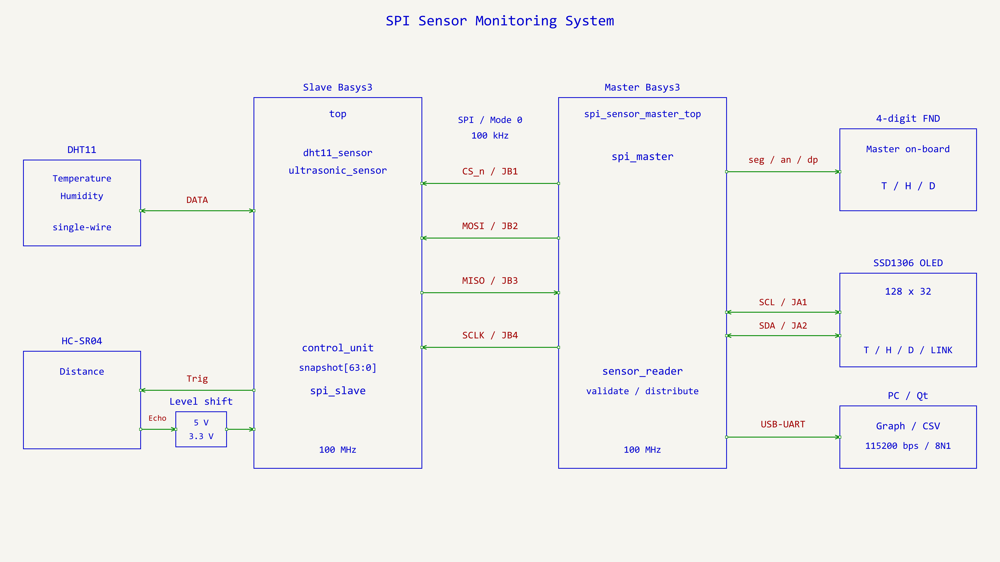
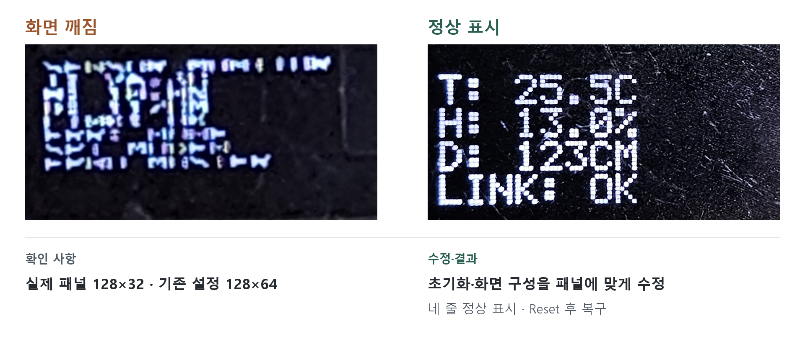

# Master 설계·검증

Master가 담당하는 SPI 수신부터 화면 표시·PC 기록까지의 구현과 확인 범위입니다.
배선·전송 형식은 [인터페이스 정의](interface.md), Qt 실행은 [PC 앱 안내](../desktop/README.md)를 참고합니다.

## 데이터 흐름과 역할



Slave는 센서를 독립적으로 측정하고 Master는 100ms마다 저장된 Snapshot을 읽습니다.
응답 검사가 끝난 뒤 같은 Clock에서 센서값·유효 상태를 반영하고, 각 출력 모듈이 이를 받아 표시합니다.

| 모듈 | 책임 |
| --- | --- |
| [spi_master](../master/spi_sensor_master.srcs/sources_1/new/spi_master.v) | Mode 0 전송, MISO 2단 동기화, 80bit Shift, CS 시간·2ms Watchdog |
| [sensor_reader](../master/spi_sensor_master.srcs/sources_1/new/sensor_reader.v) | 요청 주기, 응답 검사, 최신 값·센서 Valid·링크 상태, 500ms 수신 정지 감지 |
| [fnd_controller](../master/spi_sensor_master.srcs/sources_1/new/fnd_controller.v) | 표시 선택·숫자 변환·네 자리 Scan, 한 Scan 동안 표시값 고정 |
| [uart_reporter](../master/spi_sensor_master.srcs/sources_1/new/uart_reporter.v) / [uart_tx](../master/spi_sensor_master.srcs/sources_1/new/uart_tx.v) | 상태 Snapshot을 ASCII 레코드로 변환, 115200/8N1 송신 |
| [oled_display](../master/spi_sensor_master.srcs/sources_1/new/oled_display.v) / [oled_font](../master/spi_sensor_master.srcs/sources_1/new/oled_font.v) / [i2c_master](../master/spi_sensor_master.srcs/sources_1/new/i2c_master.v) | SSD1306 128×32 초기화·네 줄 표시·I2C ACK/Timeout 처리 |
| [reset_sync](../master/spi_sensor_master.srcs/sources_1/new/reset_sync.v) / [Top](../master/spi_sensor_master.srcs/sources_1/new/spi_sensor_master_top.v) | Reset 비동기 Assert·동기 Release, Switch 동기화·모듈 연결·상태 LED |

양쪽 보드의 System Clock은 각각 100MHz입니다. Slave 외부 SPI 입력과 Master MISO는 각 보드의 Clock으로 동기화합니다.
Master는 Verilog-2001로 작성했으며 센서 Driver·실제 Slave RTL은 팀원 담당입니다.

## 전송과 데이터 반영

- SPI FSM: `IDLE → CS_SETUP → TRANSFER → CS_HOLD → CS_GAP`. Setup/Hold 5µs, Gap 10µs.
- Mode 0의 첫 수신 Bit는 `CS_SETUP` 종료 시 처리합니다. 총 80bit 수신 후 마지막 하강 구간에서 결과를 고정합니다.
- 선택 구간의 Watchdog는 SCLK 진행과 독립적으로 동작합니다. Timeout은 CS 해제·Gap을 거쳐 오류 완료를 알립니다.
- Reset은 진행 중 전송을 취소하며 가짜 `done`을 만들지 않습니다. 초기 Gap 후 새 요청을 받습니다.
- Reader FSM: `WAIT_POLL → WAIT_TRANSFER → CHECK_FRAME`. 정상·오류 모두 다음 Poll을 기다립니다.

검사 우선순위는 **전송 오류 → 길이 → Header → XOR → 예약 Bit → 유효 필드 범위**입니다.
정상 Frame은 값·센서 Valid·링크 상태를 함께 반영합니다. 오류 Frame은 저장 수치를 보존하되 Valid와 링크 상태를 지워,
이전 값을 최신 정상값처럼 표시하지 않습니다. 성공한 Frame 없이 500ms가 지나면 `STALE`로 처리합니다.

`LINK: OK`는 Frame 형식이 정상이라는 뜻입니다. 센서가 미준비인 `STATUS=00`도 정상 응답이며 센서값만 `--`로 표시합니다.
소수 한 자리와 거리 1cm는 통신 표현 단위로, 센서의 측정 정확도를 뜻하지 않습니다.

## 표시와 PC 기록

OLED·UART는 현재 출력용 Snapshot과 최신 대기 상태 한 개를 보관합니다. 출력 중 새 상태가 오면 대기 상태를 교체하므로
SPI는 계속 동작합니다. 모든 Poll 결과를 빠짐없이 저장하는 방식은 아닙니다.

| 조작·출력 | 동작 |
| --- | --- |
| Master BTNC | Active-high Reset |
| Master SW[1:0] | 00/11 온도, 01 습도, 10 거리 |
| OLED | 온도·습도·거리·링크/오류의 네 줄. 초기화·갱신 실패 시 별도 Fault |
| UART | `T=23.5C H=60.0% D=291cm L=OK O=OK` + CRLF. 센서 Invalid는 `--` |
| Qt | 줄 경계 복원·상태 검사, 센서별 추이·기록, USB 단절 감지·수동 재접속, CSV 저장 |

Qt는 GUI Event Loop의 `readyRead`로 읽고 부분 수신·여러 줄 수신을 처리합니다.
긴 잡음은 LF까지 폐기하며 수신 기록 18,000개·상태 기록 200행으로 메모리를 제한합니다.
CSV는 저장을 누른 시점의 보관 기록이며, PC 수신 UTC·센서값·SPI/OLED 상태·새 구간 표시를 저장합니다.

### Master LED

| LED | 의미 |
| --- | --- |
| [7:0] | 최근 80bit 응답의 DIST_L 위치 Byte. 오류 Frame일 수도 있음 |
| [8], [9] | 온습도 Valid, 거리 Valid |
| [10], [11], [12] | 정상 Frame 수신 Toggle, OLED Fault, SPI Busy |
| [13], [14], [15] | 오류 코드가 0이 아님, 500ms Stale, Link Valid |

## 검증 결과

Master 회귀·배치배선은 2026-11-04, Qt 자동 시험은 2026-11-06, 실물 연동은 2026-11-05 확인 기록입니다.
Simulation의 상대 보드는 `spi_sensor_peer` 모델이며 실제 Slave RTL 검증과 구분합니다.

| Master 시험 범위 | Testbench 수 | PASS 건수 |
| --- | ---: | ---: |
| SPI 전송·Reset·Timeout | 1 | 15 |
| Reader 검사·SPI 연결 | 2 | 68 |
| FND 변환·SPI→표시 | 2 | 1,039 |
| UART Byte·Reporter·SPI→UART | 3 | 284 |
| Reset·Top 연결 | 2 | 16 |
| I2C ACK/NACK·Timeout·복구 | 1 | 16 |
| OLED 화면 RAM·Top 연결 | 2 | 9 |
| **합계** | **13** | **1,447** |

배치배선: LUT 2,688·FF 1,645·Latch/BRAM/DSP 0, 3,569 Net 배선 완료, DRC 위반 0.
10ns 내부 Clock 기준 WNS 2.441ns·WHS 0.069ns이며, 외부 SPI 입출력 지연의 Timing Closure 결과는 아닙니다.
합성 Critical Warning/Error는 0이었고, 경고 27개는 미사용 입력·숫자 변환 Bit 최적화 항목으로 검토했습니다.

QtTest는 36건 PASS로 분할 수신·형식 오류·버퍼 상한·수신 중단·CSV Snapshot·그래프 단절 등을 검사했습니다.
별도 폴더의 앱·시험 새 빌드와 100%·125%·150% 배율의 레이아웃도 확인했습니다. [Qt 검증 상세](../desktop/README.md#구조검증)

실물에서는 다음을 확인했습니다.

- 두 Basys3 간 온습도·거리 수신과 Master OLED·FND 표시. 약 20cm 물체에 OLED/FND 모두 20 표시를 사용자 확인.
- Master Reset 후 화면 복구, Slave Reset 중 `ERR:HEADER`·센서값 무효 표시, 해제 후 수신·표시 복구.
- Qt에서 개선 후 COM4 10초·100건 정상 수신, 형식 오류 0건과 CSV 대조.
- Master USB 분리·재연결 1회, Qt 수동 접속 후 기존 기록 보존·새 구간 생성·센서값 복구. 자동 재접속 시험은 아님.

### 확인 한계

센서 정확도·전 범위 동작, 외부 I/O Timing Closure, 반복 탈착 내구성은 검증하지 않았습니다.
팀원은 DHT11 소수 바이트가 0이라고 전달했지만, UART에서는 0이 아닌 소수값이 관측됐습니다.
원시 Frame과 적용된 Slave Bitstream의 대조는 남아 있습니다.
Qt는 수신값을 보정하지 않습니다. 다른 센서 Revision의 데이터 형식까지 호환된다는 의미는 아닙니다.
Slave 프로젝트는 Vivado 2020.2 생성본이며 현재 PC에서의 Slave 재빌드·모든 예외 조건 검증은 수행하지 않았습니다.

## OLED 문제 해결

당시 화면 깨짐은 Reset·이전 Bitstream 재적용으로도 복구되지 않았습니다.
실물 패널 128×32에 맞춰 초기화와 4개 Page·네 줄 화면 구성을 수정한 뒤 정상 표시·Reset 후 복구를 확인했습니다.
후속 촬영용 재현에서는 같은 증상이 발생하지 않아, 특정 초기화 값만을 단독 원인으로 확정하지 않습니다.



## 검증 실행

Vivado 2026.1 명령이 PATH에 설정된 환경에서 저장소 루트 기준으로 실행합니다.

```powershell
python scripts/verify_spi_master.py
python scripts/verify_spi_master.py --sensor
python scripts/verify_spi_master.py --fnd
python scripts/verify_spi_master.py --uart
python scripts/verify_spi_master.py --top
python scripts/verify_spi_master.py --i2c
python scripts/verify_spi_master.py --oled
```

각 명령은 해당 단위·연결 Testbench를 실행합니다. `--synth`를 붙이면 해당 모듈의 독립 합성을 수행합니다.
전체 Top의 XDC 적용 합성·배치배선·Bitstream 생성은 아래 명령으로 수행하며 보드를 Programming하지 않습니다.

```powershell
python scripts/verify_spi_master.py --top --impl
./scripts/build_monitor.ps1 -Test
./scripts/capture_uart.ps1 -Port COM4 -Seconds 8
```

COM 번호는 실제 Master 장치에 맞춥니다. Qt와 수신 도구가 동시에 같은 포트를 열 수 없습니다.
FPGA 산출물은 `master/spi_sensor_master.sim/step4/`~`step11/`, Qt 산출물은 `desktop/build*/`에 생성되어 Git에서 제외됩니다.
Bitstream·입력/출력 해시는 `step9/spi_sensor_master.bit`·`build_manifest.json`에 기록됩니다.
Vivado GUI에서는 Master XPR을 열고 필요한 Testbench를 Simulation Top으로 선택합니다.
프로젝트의 Board 설정은 `digilentinc.com:basys3:part0:1.2`입니다. 다른 PC에서는 Basys3 Board files 경로를 해당 환경에 맞춰 설정합니다.

## 구현·검증 자료

이미지는 최종 PNG만 보관합니다. 영상은 GitHub 첨부 링크로 재생하고, 저장소에도 MP4 파일을 보관합니다.

| 구분 | 자료 |
| --- | --- |
| 실물 구성 | [Master·Slave·센서 전체 사진](assets/hardware/system_setup.png) |
| Block Diagram | [전체](assets/architecture/system.png) · [Master](assets/architecture/master.png) |
| FSM | [SPI](assets/fsm/spi_master.png) · [수신 처리](assets/fsm/sensor_reader.png) |
| Testbench | [SPI 수신 결과](assets/verification/spi_receive_result.png) · [결과 반영](assets/verification/record_update.png) · [오류·복구](assets/verification/error_recovery.png) |
| 프로토콜 | [G1 시험 Frame](assets/protocol/spi_frame_g1.png) |
| PC 모니터 | [Qt](assets/desktop/monitoring.png) · [CSV](assets/desktop/csv_export.png) |
| 상태·문제 해결 | [정상/SPI 오류](assets/status/spi_error_comparison.png) · [OLED](assets/troubleshooting/oled_display_fix.png) |
| 동작 영상 | [센서 측정·오류·복구 시연](https://github.com/user-attachments/assets/2906fe24-5ce1-4fc6-8414-091c8f5ddaaa) · [MP4 파일](assets/video/sensor_monitoring_demo.mp4) |

Testbench 첫 캡처는 전송 시작이 잘려 있어 종료 상태·수신 결과를 보여줍니다. G1/G2 값은 주입한 시험값입니다.
정상 상태 비교의 OLED·Qt 캡처는 서로 다른 시점이며 측정값 일치 비교에 사용하지 않습니다.
